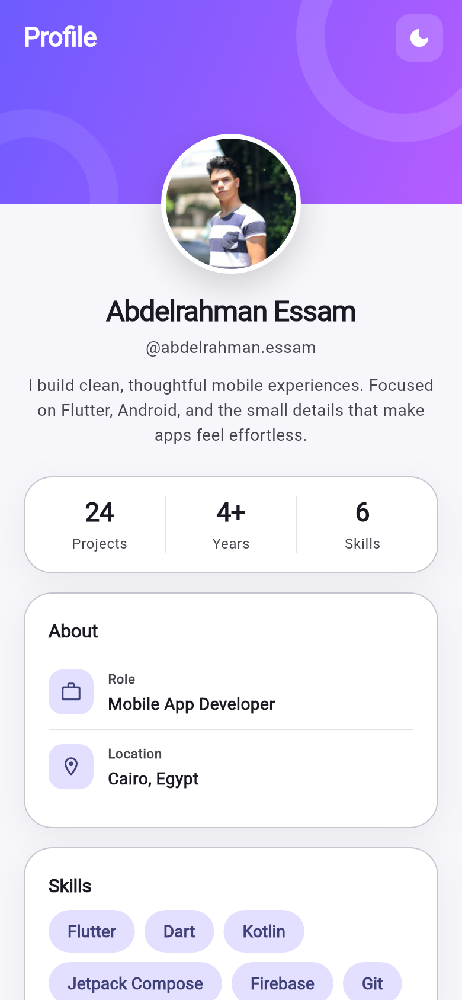
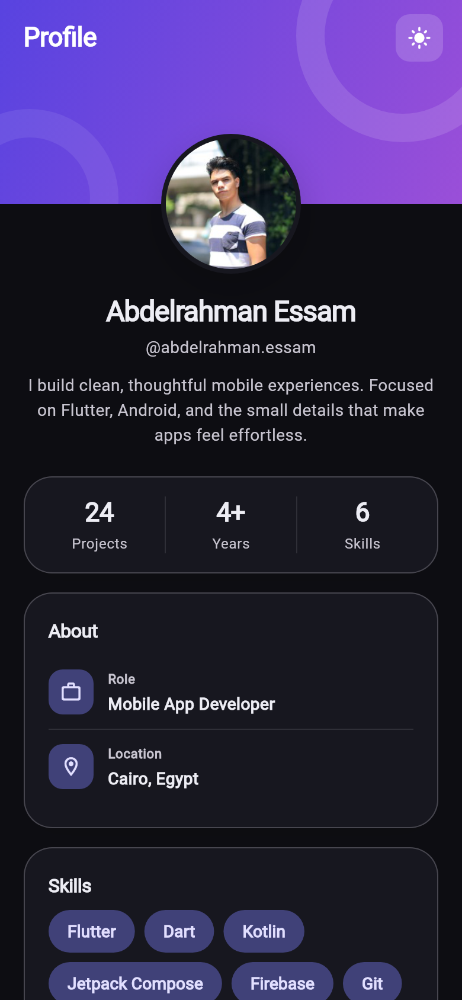

# Profile App

A clean, data-driven personal profile UI built with Flutter.

## Preview

| Light | Dark |
| --- | --- |
|  |  |

## Features

- Gradient header with an overlapping profile photo
- Light and dark themes
- Data-driven profile content (stats, details, skills)
- Centralized design tokens, colors, and strings
- Responsive layout
- No third-party packages

## Project structure

```
lib/
├── constants/      # UI strings
├── data/           # Profile content
├── models/         # Profile model
├── screens/        # Profile screen
├── theme/          # Themes, color palette, and design tokens
├── widgets/        # Reusable UI components
└── main.dart       # App entry point
```

## Run

```bash
flutter pub get
flutter run
```
